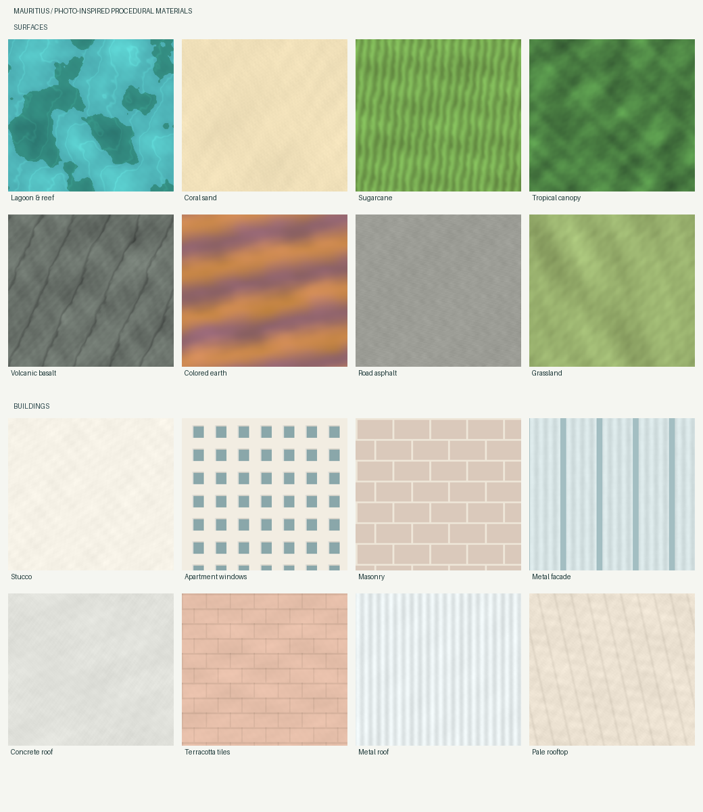

# Mauritius Open World — textured Three.js source

A run-ready **Vite + Three.js** source project rendering all regions of Mauritius in an explorable 3D map. It uses OpenStreetMap tiles and building outlines, Mapzen/AWS public elevation tiles for real terrain relief, and original photo-inspired procedural texture atlases for surfaces and buildings.

**Website:** [Explore Mauritius in 3D](https://VincentChuWaiChow.github.io/mauritius-3D-openworld/)

## Quick start

Requires Node.js 20.19+ or 22.12+, npm, WebGL2 in the browser, and internet access for OSM, public elevation and optional Overpass data.

```bash
npm ci
npm run dev
```

Open the Vite URL displayed in the terminal, normally `http://localhost:5173/mauritius-3D-openworld/`.

```bash
npm test
npm run build
npm run preview
```

## GitHub Pages

In [repository Settings → Pages](https://github.com/VincentChuWaiChow/mauritius-3D-openworld/settings/pages),
set **Build and deployment → Source → GitHub Actions** once.
The [deployment workflow](.github/workflows/deploy-pages.yml) then tests, builds,
and publishes `dist/` on each push to `master`. It can also be run manually from
the repository's **Actions** tab. The site becomes available at the website link
above after the first successful deployment.

`vite.config.js` sets the `/mauritius-3D-openworld/` project path, including local
textures. If the repository is renamed, update that base path and the website
link. No application server or API keys are required; map, elevation and building
data still require access to the external services described below.

## Implemented features

- The main island and nearby islets, Rodrigues, Agaléga and Saint Brandon; zoom into individual places including Port Louis, Grand Baie, Flic en Flac, Le Morne and the Seven Coloured Earths.
- **3D terrain:** Terrarium DEM sampling with a dynamic 0–3× relief exaggeration control. If elevation fails, the map stays navigable with flat terrain.
- **Surface textures:** lagoon/reef patterns, coral sand, crop rows, forest canopy, volcanic basalt, colored soil, asphalt and grassland. Raster-based color classification is approximate.
- **Buildings:** live Overpass footprints in detailed places; PBR lit with material-dependent facade and roof textures; `roof:material` and `building:material` tags take priority when present.
- **Rendering presets:** Tropical, Sunset, Midnight, Original OSM, plus adjustable photo-inspired texture intensity, building height exaggeration, sun shadows, orbit, pan, double-click explore and PNG capture.
- **Textured-terrain shadows:** shadow receivers share the displaced DEM mesh, so building shadows conform to the sampled terrain rather than an arbitrary flat plane.
- **Batched geometry:** local buildings are merged into batches for fewer GPU draw calls.

## Material study



The textures are **not photos**. They are original seamless/procedural patterns based on a visual study of photographs of Mauritian coasts, crops, mountains, geology and buildings. They are shipped locally in `public/textures/` and do not need network access. See [PHOTO_REFERENCES.md](PHOTO_REFERENCES.md) for image provenance, usage restrictions and design rationale.

| File | Responsibility |
|---|---|
| `src/main.js` | Three.js renderer, OSM tile streaming, user controls, camera and lighting |
| `src/terrain.js` | DEM tile loading, Terrarium RGB decoding, bilinear interpolation |
| `src/map-shaders.js` | Color/pattern mixing, terrain-informed rock and coast classification, ocean shader |
| `src/materials.js` | Texture atlases and PBR wall/roof material integration |
| `src/buildings.js` | OSM footprint extrusion, per-face pattern selection, DEM grounding and batching |
| `src/palettes.js` | Editable color, light and building palette presets |
| `scripts/generate_textures.py` | Reproducible texture atlas generation, optional PIL/numpy |
| `public/textures/*.png` | Actual bitmap textures consumed by WebGL |

## Customize styles

Edit `src/palettes.js` to change global colors and weather/light settings. Modify `src/map-shaders.js` for regional blending rules and `scripts/generate_textures.py` for the texture motifs themselves. Re-run the Python script only when you edit textures; generated PNGs are already bundled and used at runtime.

## Important accuracy constraints

1. **Not satellite photogrammetry.** Surfaces are photo-*inspired*, not photorealistic building scans or licensed photo projections.
2. **Not vector-accurate land use.** The project recolors standard OSM raster tiles; labels are embedded in raster pixels. Sugarcane/forest/roads/beaches are classified heuristically and will be imperfect. For reliable individual field/road/landuse shapes, build a vector-tile pipeline with explicit landuse/roads polygons/lines.
3. **DEM has finite resolution.** Terrain is sampled from public Mapzen elevation tiles (z10 island-wide, z12 locally); it is not an engineering grade ground survey. Heights are multiplied by relief exaggeration for readability.
4. **Buildings are streamed by location**, not bundled for the whole country. Local buildings depend on a public Overpass service and may be rate-limited, incomplete or unavailable. Height and material are estimated when not explicitly mapped. Building footprints are OSM `way` objects, not multipolygon relations.
5. **Chamarel colored-earth patch is illustrative**, centered around a photographed approximate attraction location and not the exact site boundary.
6. **Map tile use:** only 25 standard OSM raster tiles are requested for the selected area, without bulk-prefetching. Follow the [OSM tile usage policy](https://operations.osmfoundation.org/policies/tiles/) and use hosted/self-hosted vector tiles for production scale.

## Data attribution

- © [OpenStreetMap contributors](https://www.openstreetmap.org/copyright) (OSM data is under ODbL); standard raster map tiles must follow the [OSMF tile policy](https://operations.osmfoundation.org/policies/tiles/).
- Mapzen public terrain tiles via the [AWS Open Data Registry](https://registry.opendata.aws/terrain-tiles/). Terrarium elevation is `(R×256 + G + B/256) - 32768` meters.
- Application code: MIT. All material PNGs here are original procedural images, not third-party photographs.

## Test status and hardware limitation

`npm test` covers palette/terrain behavior and shader declarations, plus a production build that checks
project-relative asset URLs and bundled textures. The deployment workflow requires
these tests and `npm run build` to succeed before publishing. These checks do not
prove GPU performance or the availability of external map/elevation/building services;
those still require a WebGL2-enabled browser and network access.
